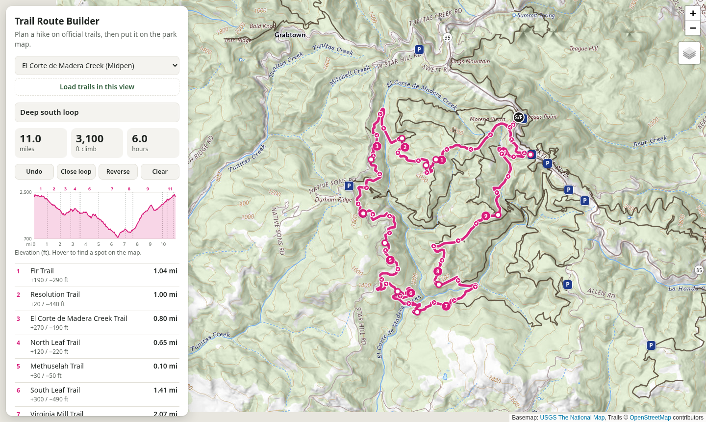

# trailroute

Plan a hike on official trails, see the distance and climb, and stamp the route
onto a park's GeoPDF map, either in the browser or from the command line.

**Web app: https://caseymillsdavis.github.io/trailroute/**



## Web route builder

- Click a trail or a **P** to start, then keep clicking. The route follows trails between your points.
  Drag a point to move it; click it to remove it.
- You get distance, climb, a time estimate, a per-trail breakdown and an elevation profile.
  Hover the profile to find that spot on the map.
- **Stamp onto a map PDF:** pick a park's GeoPDF map (for example the Midpen preserve maps at
  [openspace.org/maps](https://www.openspace.org/maps)). The route is drawn onto it, with
  direction arrows, mile markers and a summary card. Your file never leaves the browser.
- **Download GPX**, or **copy a link** that reopens the exact route.
- El Corte de Madera Creek comes preloaded. Anywhere else: pan there and press
  **Load trails in this view** to pull trails from OpenStreetMap.

Only named, official trails are routable. Paths that OpenStreetMap tags as informal, or as
private or closed, are left out, because many preserves prohibit off-trail use.

## Command-line tool

`trailroute.py` does the same stamping from a route file. It uses only the Python standard
library; `pdftoppm` is optional, for PNG previews.

```sh
python3 trailroute.py map_ECDM.pdf routes/deep_south_loop.json --gpx loop.gpx --png loop.png
python3 trailroute.py map_ECDM.pdf --list-trails     # trail + place names it knows
```

A route file names a start and the trails to follow, in order:

```json
{
  "name": "Deep south loop",
  "start": "Skeggs Point",
  "trails": ["Fir", "Resolution", "El Corte de Madera Creek", "North Leaf", "Methuselah",
             "South Leaf", "Virginia Mill", "Lawrence Creek", "Timberview", "Methuselah",
             "Sierra Morena", "Fir"]
}
```

It takes the shortest path that uses each trail in that order. If two trails meet at more than
one junction, list more trails to pin the route down. `start`/`end` can be a place name or
`[lat, lon]`. Trail and elevation downloads are cached in `~/.cache/trailroute`.

Example routes are in [`routes/`](routes).

## How it works

- **Georeferencing.** GeoPDFs carry the latitude/longitude of the map frame's corners plus the
  map projection. trailroute projects trail coordinates the same way and fits them to the page.
  On the Midpen map the fit is within 0.1 pt.
- **Trails** come from OpenStreetMap through the Overpass API. They're built into a graph and routed
  with Dijkstra.
- **Elevation:** AWS Terrain Tiles (USGS 3DEP) in the browser; USGS 3DEP 10 m via
  OpenTopoData in the CLI.
- **PDF output** is an incremental update: the original bytes are kept and the route is appended
  as its own optional-content layer ("Planned route: …"), so it can be toggled in viewers that
  show layers. The GeoPDF georeferencing is untouched.

## Development

```sh
python3 -m http.server 8765        # then open http://localhost:8765/docs/
```

`tests/browser_test.html` checks routing, elevation and PDF stamping in headless Chrome. It
needs a GeoPDF at `tests/fixtures/map_ECDM.pdf`; see the comment at the top of the file.

`tools/export_web_data.py` turns an Overpass download into the compact trail file the web app
ships with (`docs/data/`).

## Credits

- Trail data © [OpenStreetMap](https://www.openstreetmap.org/copyright) contributors, ODbL.
- Basemaps: USGS The National Map; OpenTopoMap (CC-BY-SA).
- Elevation: [AWS Terrain Tiles](https://registry.opendata.aws/terrain-tiles/), USGS 3DEP,
  [OpenTopoData](https://www.opentopodata.org/).
- Park maps belong to their publishers (Midpen maps © Midpeninsula Regional Open Space District)
  and are not included here.

Distances, climb and times are estimates. Check current trail conditions with the land manager
before you go, and stay on designated trails.
